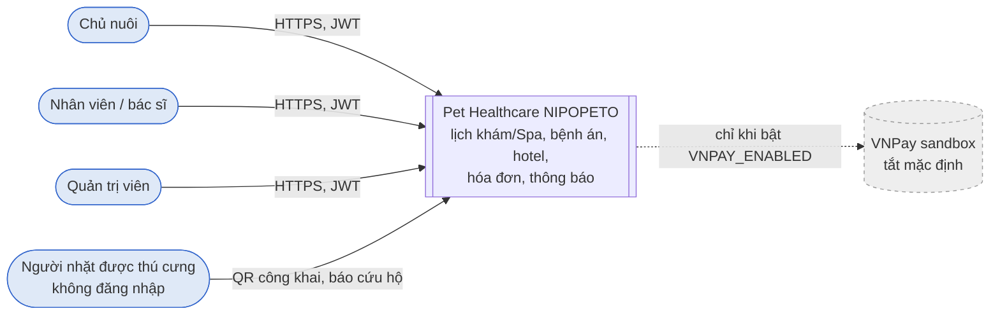

# C4 — System context

| Tác nhân                    | Dùng hệ thống để                                                                    | Ranh giới tin cậy                                                                        |
| --------------------------- | ----------------------------------------------------------------------------------- | ---------------------------------------------------------------------------------------- |
| Chủ nuôi                    | Quản lý thú cưng, đặt lịch khám/Spa/hotel, xem bệnh án, hóa đơn, thông báo của mình | JWT RS256 do Core cấp; mọi service kiểm owner scope trên list, detail, counts và related |
| Nhân viên, bác sĩ, quản trị | Tạo hồ sơ khách tại quầy, xử lý lịch, bệnh án, hotel, chốt phí, gửi thông báo       | Quyền theo role trong JWT; `internalNote` chỉ staff thấy                                 |
| Người nhặt được thú cưng    | Mở trang QR, gửi báo cứu hộ                                                         | Không đăng nhập; chỉ token QR, có rate limit và retry không nhân đôi                     |
| VNPay                       | Thanh toán trực tuyến                                                               | Tắt mặc định (`VNPAY_ENABLED=false`); không thuộc phạm vi đo Pha 2                       |

**Ngoài phạm vi:** HA/SLA production, object storage riêng cho ảnh, quản trị nhân sự/kho thuốc. Xem [phase2-plan/06 §4](../../phase2-plan/06-functional-nonfunctional-requirements.md).

**Nguồn:** [README gốc](../../README.md) (phạm vi nghiệp vụ), [phase2-plan/06](../../phase2-plan/06-functional-nonfunctional-requirements.md) (FR01–FR10, NFR04).
