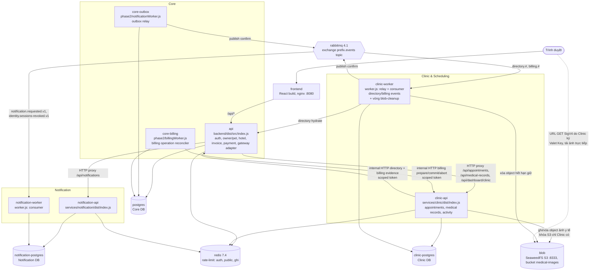

# C4 — Containers

Sơ đồ theo cấu hình thật: [`docker-compose.yml`](../../docker-compose.yml) + [`docker-compose.phase2.yml`](../../docker-compose.phase2.yml) (chế độ strict local) và topology broker trong [`packages/messaging/src/index.ts`](../../packages/messaging/src/index.ts). Môi trường thử Kaggle chạy cùng các process này dưới Nginx, xem [06](06-deployment.md).

## Container

| Container             | Entry point                                                                 | Trách nhiệm                                                                                                                                                                                                                                                                                          | Dữ liệu                           |
| --------------------- | --------------------------------------------------------------------------- | ---------------------------------------------------------------------------------------------------------------------------------------------------------------------------------------------------------------------------------------------------------------------------------------------------- | --------------------------------- |
| `api` (Core)          | `backend/dist/src/index.js` (qua `tools/docker/core-local-start.mjs`)       | Login/RS256 signing, owner/pet, hotel, invoice/payment, operation status, directory internal API, adapter tương thích cho frontend                                                                                                                                                                   | Core DB                           |
| `core-outbox`         | `backend/dist/src/workers/notification.js`                                  | Relay `OutboxEvent` Core → RabbitMQ (publish confirm)                                                                                                                                                                                                                                                | Core DB                           |
| `core-billing`        | `backend/dist/src/workers/billing.js`                                       | Điều phối và đối soát billing operation PREPARING → COMMITTED/ABORTED với Clinic                                                                                                                                                                                                                     | Core DB                           |
| `clinic-api`          | `services/clinic/dist/index.js`                                             | Lịch khám/Spa, bệnh án/ảnh, list/calendar qua query port, activity reader                                                                                                                                                                                                                            | Clinic DB                         |
| `clinic-worker`       | `services/clinic/dist/worker.js`                                            | Relay outbox Clinic; consumer `directory.#`, `billing.#` → inbox idempotent → DirectoryProjection/billing reservation                                                                                                                                                                                | Clinic DB                         |
| `notification-api`    | `services/notification/dist/index.js`                                       | Hộp thư, đếm chưa đọc, đánh dấu đọc/xóa, gửi thủ công                                                                                                                                                                                                                                                | Notification DB                   |
| `notification-worker` | `services/notification/dist/worker.js`                                      | Consumer `notification.requested.v1` → inbox idempotent → Notification; consumer riêng cho `identity.sessions-revoked.v1` → mốc thu hồi phiên                                                                                                                                                        | Notification DB                   |
| `frontend`            | `Dockerfile.frontend` runtime                                               | React build; gọi `/api/*` qua Core                                                                                                                                                                                                                                                                   | —                                 |
| `blob`                | SeaweedFS 3.97 (S3 API, một node, volume `phase2_blob`, cổng loopback 8333) | Bucket `medical-images`: nội dung ảnh y tế theo Claim Check + Valet Key (AQ-09). Chỉ `clinic-api` và `clinic-worker` có khóa S3; trình duyệt đọc bằng URL GET đã ký. Bucket lỗi thì thao tác ảnh trả 503, lịch hẹn và bệnh án vẫn chạy (không nằm trong `/health/ready`). Xem [06](06-deployment.md) | Object (khóa S3 riêng của Clinic) |
| `rabbitmq`            | image `rabbitmq:4.1-management-alpine`                                      | Exchange topic `<prefix>.events`; queue cho từng consumer kèm `.dlq`                                                                                                                                                                                                                                 | —                                 |
| `redis`               | image `redis:7.4-alpine`                                                    | Counter rate limit dùng chung giữa replica cho đăng nhập, đường `/auth`, `/public` và mọi request ghi. GET/HEAD còn lại đếm trong bộ nhớ từng instance, không gọi Redis ([06](06-deployment.md))                                                                                                     | —                                 |

## Kênh giao tiếp

| Kênh                                     | Kiểu                                                                                    | Đảm bảo                                                                                                                                                                                                                                                                                           | Nguồn                                                                                         |
| ---------------------------------------- | --------------------------------------------------------------------------------------- | ------------------------------------------------------------------------------------------------------------------------------------------------------------------------------------------------------------------------------------------------------------------------------------------------- | --------------------------------------------------------------------------------------------- |
| Browser → Core → Clinic/Notification     | HTTP đồng bộ, JWT người dùng                                                            | Owner scope kiểm ở service sở hữu dữ liệu; Core không đọc DB service khác                                                                                                                                                                                                                         | `backend/src/composition/coreApp.ts`                                                          |
| Clinic → Core directory/billing evidence | HTTP nội bộ, token theo phạm vi (`CORE_DIRECTORY_TOKEN`, `CORE_BILLING_EVIDENCE_TOKEN`) | Chỉ đọc Core DB, không gọi vòng về Clinic                                                                                                                                                                                                                                                         | `services/clinic/src/infrastructure/core/directory.ts`, [phase2-plan/01 §2](../../phase2-plan/01-architecture.md) |
| Core billing → Clinic                    | HTTP nội bộ (`CLINIC_BILLING_TOKEN`)                                                    | Reservation HELD/INVOICED, operation COMMITTED/ABORTED nhất quán                                                                                                                                                                                                                                  | `backend/src/composition/appointmentBilling.ts`, [ADR-04](07-adr-index.md)                    |
| Outbox → RabbitMQ → Inbox                | Bất đồng bộ, at-least-once                                                              | Ghi nghiệp vụ và outbox cùng transaction; publish confirm; inbox khử trùng theo `eventId`; retry qua delay queue (1 s, 5 s, 30 s, 2 phút, 10 phút) rồi DLQ, lỗi vĩnh viễn vào DLQ ngay ([ADR-P03](../../phase2-plan/architecture-work/adr-p03-messaging-retry.md)); replay từng event hoặc cả DLQ | `packages/messaging`, `packages/contracts`                                                    |

**Routing key và queue** (`declareTopology`):

| Routing key                    | Queue                   | Consumer                                                                        |
| ------------------------------ | ----------------------- | ------------------------------------------------------------------------------- |
| `notification.requested.v1`    | `<prefix>.notification` | notification-worker                                                             |
| `identity.sessions-revoked.v1` | `<prefix>.identity`     | notification-worker (queue riêng để thu hồi phiên không xếp sau thông báo, P03) |
| `directory.#`, `billing.#`     | `<prefix>.clinic`       | clinic-worker                                                                   |

Queue `<prefix>.clinic-read-v1` (routing key `clinic.appointment-read-changed.v1`, consumer `clinic-read-worker`) đã bị gỡ cùng projection CQRS ở `be2267b`. Queue cũ còn trên broker được dọn lúc deploy bằng `tools/phase2/retire-clinic-read-queues.mjs` theo [runbook migration A](../../deploy/phase2/migration-a-runbook.md).

Mỗi queue có một `.dlq` và các delay queue `.retry.<ms>ms` tương ứng. Envelope (`packages/contracts`) gồm `eventId`, `eventType`, `schemaVersion: 1`, `producer`, `aggregateType/Id/Version`, `occurredAt`, `correlationId`, `payload`, và được kiểm schema chặt theo từng loại event.
