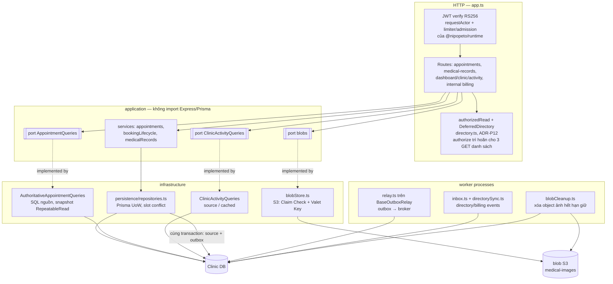

# C4 — Components: Clinic & Scheduling

Clinic là service có nhiều quyết định kiến trúc nhất: ports/adapters, đọc danh sách trực tiếp từ bảng nguồn với authorize trì hoãn, daily summary activity, Claim Check + Valet Key cho ảnh y tế, billing reservation, inbox/outbox. Code ở [`services/clinic/src`](../../services/clinic/src).

Projection CQRS (projector, read worker, rebuild, reader `shadow`/`projection`, mode `summary`/`control` của activity) đã gỡ khỏi main ở `be2267b` ngày 28/10/2026; xem mục cuối.

## Tầng và quy tắc phụ thuộc

| Tầng           | Thư mục                                                                                                      | Quy tắc                                                            |
| -------------- | ------------------------------------------------------------------------------------------------------------ | ------------------------------------------------------------------ |
| Domain         | `domain/` (auth, error, validation, scheduling: Value Object `TimeRange`, Specification `checkSlot` của P10) | Không import framework hay DB                                      |
| Application    | `application/services`, `application/ports`, `application/queries`                                           | Chỉ phụ thuộc port. Business không nhận `Prisma.TransactionClient` |
| Infrastructure | `infrastructure/persistence`, `infrastructure/queries`                                                       | Prisma adapter triển khai port                                     |
| Composition    | `app.ts`, `runtime.ts`                                                                                       | Lắp adapter theo cấu hình (`CLINIC_ACTIVITY_MODE`, `BLOB_*`)       |

Phần chung giữa các service nằm ở package, không chép trong service: xác thực token và actor, kiểm URL service, error handler dùng chung (`failures.ts`, `requestFault.ts`) ở `@nipopeto/runtime`; lõi relay `BaseOutboxRelay` ở `@nipopeto/messaging` (`0f169d0`). Rule `no-duplicated-service-modules` chặn việc chép lại file giống hệt giữa các service.

**Kiểm tự động:**

- `tools/phase2/check-boundaries.mjs` (`npm run phase2:test:architecture`) kiểm ranh giới **giữa** các service: không import chéo, shared package không chứa persistence, không SQL vào DB service khác, mỗi service có Prisma client riêng.
- Quy tắc tầng **bên trong** Clinic (domain/application không import Express, Prisma, amqplib, infrastructure) được kiểm bởi rule (1) của `tools/phase2/check-architecture-rules.mjs` trong `arch:check`. `backend/scripts/check-architecture.mjs` áp cho Core.

Xem [09](09-fitness-functions.md).

## Đặt lịch theo tài nguyên (P10)

- `AppointmentService` hỏi port `slotPolicy` (dữ liệu trong `appointment_resource_groups`, `appointment_type_policies`), rồi `checkSlot` trả 422 khi ngoài giờ hoặc lệch lưới.
- Sức chứa và chồng giờ (pet, bác sĩ) do trigger trong DB chặn, nên đúng cho mọi đường ghi, kể cả khi đồng thời. `appointmentSlotConflict.ts` đổi lỗi của trigger thành 409 có mã.
- `GET /api/appointments/availability` là Query Object: liệt kê khung giờ của một ngày và số chỗ còn, đọc từ bảng slot. Đây chỉ là gợi ý; lúc tạo lịch vẫn kiểm lại.
- DTO lịch hẹn có `allowedActions` (P01) tính từ bảng vòng đời trong contracts và quyền của người xem.

## Đường đọc danh sách lịch

Port `AppointmentQueries` hiện chỉ có một cài đặt: `AuthoritativeAppointmentQueries` (SQL trên bảng nguồn trong snapshot RepeatableRead; `infrastructure/queries/authoritativeAppointments.ts`, `authoritativeLists.ts`). Reader `shadow` và `projection` cùng biến `CLINIC_READ_MODE` không còn trong service.

**Authorize trì hoãn ([ADR-P12](../../phase2-plan/architecture-work/adr-p12-deferred-list-authorization.md)):** với các GET đúng đường dẫn `/appointments`, `/medical-records`, `/medical-records/images`, khi circuit breaker tới Core đang đóng:

1. Clinic đọc DB trước.
2. Clinic gọi Core **một** lần `authorize`, kèm petId ban đầu và các petId/ownerId của trang; Core trả quyết định và snapshot tên trong cùng một lần đọc (trước đây hai lần: `authorize` rồi `lookup`).
3. `DeferredDirectory` và `failClosed` (`directory.ts`) bảo đảm response 2xx chưa được Core xác nhận thì đổi thành 503; lỗi từ Core được ưu tiên hơn lỗi local.
4. Đường ghi, route có id, `/calendar`, HEAD, và mọi trạng thái breaker khác vẫn hỏi Core trước khi chạm DB.

Rule `deferred-reads-via-authorized-read` trong `arch:check` bảo đảm cả ba route đi qua `authorizedRead`. Rule `clinic-core-calls-confined` giữ mọi lời gọi HTTP tới Core trong `directory.ts` và `directorySync.ts`, kể cả qua `node:http2`, `node:net`, `node:tls`, `undici`, `globalThis.fetch`, import động và `require`. Bỏ hẳn lời gọi đồng bộ này đã được cân nhắc và hoãn ([ADR-P13](../../phase2-plan/architecture-work/adr-p13-local-read-authorization.md)).

## Xử lý lỗi HTTP

Error handler của Clinic đi theo thứ tự:

1. Lỗi nghiệp vụ trả status của chính nó.
2. Body bị parser từ chối (sai JSON, quá lớn, charset lạ) trả 4xx của parser kèm text cố định (`requestFault`, `63f47da`).
3. Prisma báo không tìm thấy bản ghi (P2025) trả 404.
4. Lỗi tạm thời (database, broker, Core không trả lời, breaker đang từ chối) trả 503 kèm `Retry-After: 1` (`isTransientFailure`).
5. Còn lại là bug: 500 `INTERNAL_ERROR`, log một dòng chỉ gồm tên lớp lỗi và mã, không có message hay stack (`reportUnexpected`, `c5c2655`).

## Activity dashboard (`CLINIC_ACTIVITY_MODE`)

| Mode                | Hành vi                                           |
| ------------------- | ------------------------------------------------- |
| `source` (mặc định) | `GROUP BY` trên nguồn trong snapshot RR read-only |
| `cached`            | Như source, TTL tuyệt đối 5s                      |

Giá trị khác bị từ chối (`INVALID_CLINIC_ACTIVITY_MODE`). Mode `summary` và `control` đã gỡ cùng projection.

## Ảnh y tế (AQ-09)

Port `blobs` (`application/ports/blobs.ts`) do `blobStore.ts` triển khai trên S3. Ghi đi qua API Clinic (kiểm chữ ký file, giới hạn 7 MB); đọc bằng URL GET đã ký sau khi Clinic kiểm quyền (Valet Key); `blobCleanup.ts` chạy trong `clinic-worker` để xóa object của ảnh hết hạn giữ. Bucket lỗi hoặc không cấu hình thì thao tác ảnh trả 503, phần còn lại của Clinic vẫn chạy. Chi tiết vận hành: [06](06-deployment.md); quyết định: [ADR-AQ09-R](../../phase2-plan/architecture-work/adr-aq09-image-retention.md).

## Projection CQRS đã gỡ (28/10/2026)

- Đã gỡ ở `be2267b` (142 file, 8.270 dòng): `appointmentProjector.ts`, `readWorker.ts`, `readRebuild.ts`, `readFreshness.ts`, `activitySummaryEvidence.ts`, các reader `shadow`/`projection`, mode `summary`/`control`. Bản cũ nằm ở tag `cqrs-projection-archive-20261028` (cục bộ, chưa push).
- Giữ lại: bảng và model Prisma `AppointmentReadRow`, `AppointmentDailySummary`, `ClinicReadRevision` (grant runtime chỉ còn SELECT), mọi migration cũ, các ADR.
- Migration `20261028000100_retire_cqrs_database_hooks` (`d505faa`) bỏ trigger `read_rebuild_fence` trên 16 bảng cùng function của nó, bỏ trigger `appointment_query_source_membership` và đóng các dòng outbox `clinic.appointment-read-changed.v1`. Queue `P.clinic-read-v1`, `.dlq` và `.retry.*` trên broker được dọn lúc deploy bằng `tools/phase2/retire-clinic-read-queues.mjs` ([runbook migration A](../../deploy/phase2/migration-a-runbook.md)).
- Lý do và bằng chứng: [phụ lục ADR-CQRS-06](../../phase2-plan/cqrs/evidence/adr-cqrs-06.md#phụ-lục-28102026-projection-đã-gỡ-khỏi-main). Các kết quả Q2–Q5, D2–D5 và list study trong `phase2-plan/cqrs/` mô tả mã đã gỡ; đọc như lịch sử.
