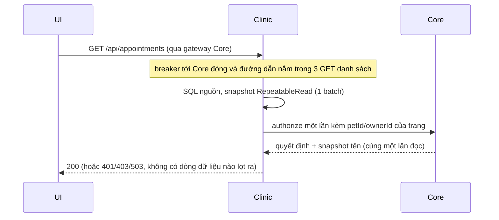

# Runtime flows

Các luồng dưới đây mô tả hành vi trong code; giao thức đầy đủ và các invariant I01–I12 nằm ở [phase2-plan/02-contracts-and-consistency.md](../../phase2-plan/02-contracts-and-consistency.md).

## 1. Ghi nghiệp vụ → outbox → broker → inbox (at-least-once)

```mermaid
sequenceDiagram
  participant C as Client
  participant API as Clinic API
  participant DB as Clinic DB
  participant R as clinic-worker relay
  participant MQ as RabbitMQ
  participant W as Consumer (vd notification-worker)
  participant NDB as Notification DB
  C->>API: PATCH /api/appointments/:id/status (JWT, Idempotency-Key)
  API->>DB: BEGIN; lock appointment; kiểm revision/slot/reservation
  API->>DB: UPDATE appointment + BookingStatusEvent
  API->>DB: INSERT OutboxEvent (notification.requested.v1)
  API->>DB: COMMIT
  API-->>C: 200 (không chờ broker)
  R->>DB: claim 1 row FOR UPDATE SKIP LOCKED, lease 30s
  R->>MQ: publish persistent, mandatory, publisher confirm
  MQ-->>R: confirm
  R->>DB: publishedAt (chỉ chủ lease hiện hành)
  MQ->>W: deliver (manual ACK)
  W->>NDB: BEGIN; INSERT InboxEvent(consumer,eventId) unique; tác dụng nghiệp vụ; COMMIT
  W-->>MQ: ACK sau commit
```

| Lỗi                                                 | Hành vi                                                                                                                                                                                                                                        | Nguồn                                                                                                            |
| --------------------------------------------------- | ---------------------------------------------------------------------------------------------------------------------------------------------------------------------------------------------------------------------------------------------- | ---------------------------------------------------------------------------------------------------------------- |
| Broker dừng                                         | API vẫn commit nghiệp vụ và outbox trong giới hạn backlog (admission 503 khi vượt); relay backoff tối đa 60s, rồi gửi lại                                                                                                                      | `services/clinic/src/infrastructure/messaging/relay.ts`, `packages/runtime/src/http.ts` (backlog guard: "Event backlog capacity reached") |
| Crash sau confirm, trước khi đánh dấu `publishedAt` | Gửi lại; inbox chặn tác dụng trùng                                                                                                                                                                                                             | `relay.ts`, inbox unique `(consumer, eventId)`                                                                   |
| Consumer lỗi tạm thời (P03)                         | Publish vào `<queue>.retry.<ms>ms` (TTL, dead-letter về `<queue>`), message kế tiếp chạy ngay; thang 1 s, 5 s, 30 s, 2 phút, 10 phút (`BROKER_RETRY_DELAYS_MS`), hết thang thì vào `<queue>.dlq`; chỉ ACK bản gốc sau khi bản mới được confirm | `packages/messaging/src/index.ts` (`consumeEvents`, `retryTarget`)                                               |
| Lỗi vĩnh viễn, sai schema, loại không nhận          | Vào `<queue>.dlq` ngay lần đầu (`p2-failure=permanent`); mỗi service liệt kê mã vĩnh viễn, lỗi lạ được retry                                                                                                                                   | `services/*/src/messagingErrors.ts`                                                                              |
| Sửa xong lỗi                                        | `replayEvent` phát lại **một** event từ DLQ; `replay-event.mjs <queue> --all [--max N]` phát lại theo thứ tự, dừng ở event hỏng hoặc lặp; giữ nguyên `eventId`                                                                                 | `replayEvent`, `replayAll`                                                                                       |

**Bằng chứng:**

- P2–P6 DONE (fault/restart/DLQ trên stack thử): [phase2-plan/STATUS](../../phase2-plan/STATUS.md).
- F05 ×3 (worker tắt 60s, backlog ≤261, catch-up ≤9,7s, diff 0): D5 readiness (d5-readiness-tooling-20261021, ghi chú nội bộ, không có trong repo).
- P03 (đo trước/sau, [ADR-P03](../../phase2-plan/architecture-work/adr-p03-messaging-retry.md)): một event directory lúc Core dừng 5 s không còn vào DLQ; thu hồi phiên sau 500 thông báo 19–30 ms (trước 4,4–5,8 s) nhờ queue `identity` riêng. Probe giả lập Core trả 503 bằng một server giả, không restart process Core. Kết quả gốc của lần chạy lại 29/10: [`p03-after-20261029/result.json`](../../benchmarks/phase2/Results/p03-after-20261029/result.json).
- Process thật: `billing.test.mjs` kill Core sau khi reservation đã HELD rồi worker hoàn tất đúng operation đó; `proof.test.mjs` dừng broker thật và backlog outbox được giao lại sau khi broker chạy lại.

## 2. Đường đọc danh sách lịch (authoritative, authorize trì hoãn)



- Chỉ còn một đường đọc: bảng nguồn. Không có read model, không có projector, không có read token hay fallback. `CLINIC_READ_MODE`, `X-Clinic-Read-Source` và `X-Clinic-Projection-Generation` đã gỡ cùng projection CQRS ở `be2267b`.
- `/appointments`, `/medical-records`, `/medical-records/images` đọc dữ liệu trước rồi gọi Core `authorize` **một** lần ([ADR-P12](../../phase2-plan/architecture-work/adr-p12-deferred-list-authorization.md)). Response 2xx mà Core chưa xác nhận thì đổi thành 503 (fail-closed). Đường ghi, route có id, `/calendar`, HEAD, và khi breaker không đóng thì vẫn hỏi Core trước khi chạm DB.
- Quyền luôn được kiểm tại nguồn, nên không có cache TTL và không bỏ bước kiểm thu hồi phiên ([ADR-05](07-adr-index.md)).

**Bằng chứng:**

- `directory-cache` (một lần gọi Core cho mỗi GET danh sách, bảng 3 route × 7 ca) và `phase2:test:clinic` (token bị thu hồi → 401 trên cả ba danh sách; owner A dùng petId của owner B → 403): [ADR-P12](../../phase2-plan/architecture-work/adr-p12-deferred-list-authorization.md).
- Đo trên VM: H1/H0 p95 GET appointments 0,603, p95 toàn bộ 0,868 ([bridge](../../phase2-plan/bridge/README-20261028.md), mục "Kết quả VM"). Đây là hiệu quả gộp của nhiều thay đổi, không tách riêng được ADR-P12.
- **Hệ quả cần biết:** Core ngừng thì ba GET danh sách của Clinic cũng trả 503, vì quyền luôn hỏi Core. Đây là đánh đổi có chủ ý ([ADR-P13](../../phase2-plan/architecture-work/adr-p13-local-read-authorization.md)).
- Q4/Q5 và list study CQRS mô tả mã đã gỡ; đọc như lịch sử (CQRS STATUS, ghi chú nội bộ, không có trong repo).

## 3. Activity dashboard

`GET /api/dashboard/clinic/activity` (chỉ admin) → `ClinicActivityQueries`, mode `source` (mặc định, `GROUP BY` trên nguồn trong snapshot RR read-only) hoặc `cached` (như source, TTL tuyệt đối 5s). Mode `summary` và `control` (daily summary V2) đã gỡ cùng projection.

**Bằng chứng lịch sử** (ghi chú nội bộ, không có trong repo): D4 (d4-summary-reader-20261021) và D5 Kaggle (d5-kaggle-result-ba33c751-20261021) mô tả mode `summary` đã gỡ.

## 4. Lập hóa đơn cho lịch khám (giao dịch liên service không dùng 2PC)

```mermaid
sequenceDiagram
  participant UI
  participant Core
  participant Clinic
  participant MQ as RabbitMQ
  UI->>Core: POST /api/invoices + Idempotency-Key
  Core->>Core: BillingOperation PREPARING (commit)
  Core->>Clinic: prepare(operationId, appointmentId, revision) — internal token
  Clinic->>Clinic: lock appointment; reservation HELD + snapshot
  Clinic-->>Core: snapshot
  Core->>Core: lock operation PREPARING → invoice + COMMITTED + outbox (1 transaction)
  Core-->>UI: 201 invoice (hoặc 202 + operationId nếu quá deadline)
  Core->>MQ: billing.invoice-issued.v1 (relay)
  MQ->>Clinic: finalize idempotent → INVOICED
```

| Trạng thái         | Quy tắc                                                                                                                         |
| ------------------ | ------------------------------------------------------------------------------------------------------------------------------- |
| Core operation     | `PREPARING → COMMITTED` hoặc `PREPARING → ABORTED`; không hồi sinh. Abort và commit khóa cùng một hàng nên chỉ một bên thắng    |
| Clinic reservation | `HELD → INVOICED` hoặc `HELD → RELEASED`. Chỉ release sau khi Core đã ABORTED bền vững; timeout hay 404 không đủ làm bằng chứng |
| Phục hồi           | `core-billing` reconciler có lease, retry có giới hạn; UI tra `GET /api/operations/:id` khi nhận 202                            |

**Bằng chứng:** P4 DONE (crash/race/response loss/snapshot), billing proof 12/12 ([phase2-plan/STATUS](../../phase2-plan/STATUS.md), [p4-billing](../../phase2-plan/evidence/p4-billing.md)).

## 5. Directory projection (Clinic tra cứu owner/pet/staff)

- Core phát `directory.owner-upserted.v1`, `directory.pet-upserted.v1`, `directory.staff-upserted.v1` (có `sourceVersion`).
- Clinic inbox ghi `DirectoryProjection` theo `sourceVersion` tăng dần; thiếu dữ liệu thì hydrate qua Core directory API nội bộ.
- Projection chỉ dùng cho search/`related`. Quyền truy cập luôn kiểm theo dữ liệu nguồn và JWT ([ADR-05](07-adr-index.md)).

**Bằng chứng:** P3 DONE ("search lag đạt trên hai process Clinic") — [p3-clinic](../../phase2-plan/evidence/p3-clinic.md).

## 6. Mã lỗi khi hỏng (quy ước chung, từ 29/10/2026)

| Tình huống                                                                            | Trả về                                       | Vì sao                                                                                               |
| ------------------------------------------------------------------------------------- | -------------------------------------------- | ---------------------------------------------------------------------------------------------------- |
| Body bị parser từ chối                                                                | 4xx của parser (400, 413, 415), text cố định | Lỗi của bên gọi, không phải bug hay outage (`requestFault`)                                          |
| Dependency không trả lời, lỗi DB tạm thời, breaker đang từ chối                       | 503 kèm `Retry-After`                        | Gửi lại cùng request có thể thành công. SQLSTATE được phân loại ở `packages/runtime/src/failures.ts` |
| Không xác minh được điều kiện nhận lệnh ghi (Redis, DB, backlog), hoặc backlog đã đầy | 503 kèm `Retry-After` 2–5 s                  | Fail closed cho ghi (`packages/runtime/src/http.ts`)                                                 |
| Vượt rate limit                                                                       | 429 kèm `Retry-After`                        | Theo cửa sổ của limiter                                                                              |
| Lỗi không lường trước                                                                 | 500 `INTERNAL_ERROR`                         | Là bug; log chỉ có tên lớp lỗi và mã                                                                 |

503 tính vào alert `Http5xxRatioHigh`, 4xx của parser thì không ([10](10-observability.md)). Monolith Pha 1 (`backend/src/legacy/app.ts`, chạy khi tắt runtime) không dùng quy ước này: lỗi body-parser kiểu charset vẫn trả 500. Đây là stack cũ đã rào, xem bàn giao ([STATUS.md](../../phase2-plan/STATUS.md)) §2.1.
