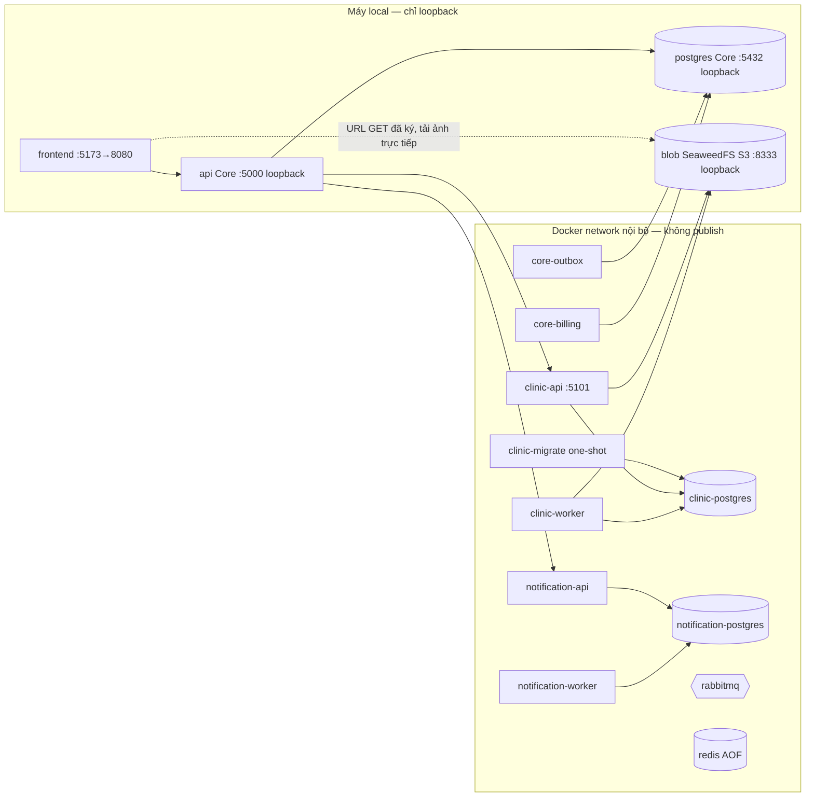

# Deployment views

Pha 2 có ba môi trường. Không có môi trường production/HA; một PostgreSQL server chứa nhiều DB vẫn dùng chung CPU/IO và là một điểm lỗi ([phase2-plan/06 §4](../../phase2-plan/06-functional-nonfunctional-requirements.md)).

## 1. Local Docker Compose (strict mode)

`docker compose -f docker-compose.yml -f docker-compose.phase2.yml`, chạy trên storage mới ([README gốc](../../README.md)).

- **Thứ tự khởi động:** `clinic-migrate` hoàn tất → `clinic-api` healthy → `api` healthy → `clinic-worker`, `core-billing`. Healthcheck gọi `/health/ready`; readiness chỉ phụ thuộc DB của chính service ([10](10-observability.md)).
- **Credential:** mỗi kênh có biến riêng, sinh bằng `tools/docker/prepare-phase2.mjs`.
  - JWT RS256: Core giữ `JWT_PRIVATE_KEY`; service khác chỉ có `JWT_PUBLIC_KEY`, `JWT_ISSUER`, `JWT_AUDIENCE`, `JWT_KEY_ID`.
  - Token nội bộ theo phạm vi: `CORE_DIRECTORY_TOKEN`, `CORE_BILLING_EVIDENCE_TOKEN`, `CLINIC_BILLING_TOKEN`. `CLINIC_BOOTSTRAP_TOKEN` đã gỡ khỏi compose và môi trường test ở `d505faa`; riêng harness `stack.mjs` cố ý giữ vì cấu hình H0 của benchmark cần nó.
  - Khác: `RATE_LIMIT_KEY_SECRET`, `OBSERVABILITY_TOKEN`, `BROKER_PASSWORD`, `BLOB_ACCESS_KEY` và `BLOB_SECRET_KEY` (khóa S3 của Clinic, cũng do `prepare-phase2.mjs` sinh; cấu hình dở dang một nửa bị từ chối với `PARTIAL_BLOB_CONFIGURATION`).
  - Strict mode từ chối chạy khi hai token trùng nhau (`DISTINCT_SERVICE_CREDENTIALS_REQUIRED`).
- **Rate limit (`packages/runtime/src/http.ts` `policy`):** có hai nơi đếm.

  - **Trong bộ nhớ từng instance (từ `049b8a5`):** GET/HEAD trừ các đường `/auth`, `/public`. Không gọi Redis, Redis chết không ảnh hưởng. Ngưỡng tính riêng từng instance, nên N replica cho phép tối đa N lần ngưỡng; chấp nhận được vì GET không phải điểm bị lạm dụng. Bộ nhớ có trần `LOCAL_LIMITER_MAX_ENTRIES` (mặc định 10000).
  - **Redis, dùng chung giữa replica:** đăng nhập, đường `/auth`, `/public` và mọi request ghi.

  Ngưỡng đọc từ env, giá trị sai (≤0, không phải số nguyên) → request bị từ chối 503, không tắt limiter. Từ 22/10, `POST /api/public/pets/:token/rescue-reports` có nhóm riêng `public-rescue`: `RESCUE_REPORT_IP_LIMIT` (mặc định 20) và `RESCUE_REPORT_TOKEN_LIMIT` (mặc định 5) mỗi 15 phút; từ 23/10 thêm `RESCUE_REPORT_TOKEN_DAILY_LIMIT` (mặc định 20) mỗi 24 giờ cho mỗi token; vượt ngưỡng → 429 kèm `Retry-After`. Ghi bị fail closed khi Redis mất; GET ở `/auth`, `/public` chuyển sang đếm cục bộ kèm `X-Service-Degraded: redis` ([11](11-aq-status-20261022.md), E-b). Cùng người báo (cùng số điện thoại) báo lại một pet trong 10 phút được gộp: không thêm dòng, không gửi thêm thông báo cho chủ (AQ-01).

- **Object storage cho ảnh y tế (AQ-09, Claim Check + Valet Key):** service `blob` trong `docker-compose.phase2.yml` là SeaweedFS 3.97 với S3 API, một node, volume `phase2_blob`, cổng `127.0.0.1:8333` (loopback). Ảnh y tế không còn là base64 trong PostgreSQL của Clinic; dòng DB chỉ giữ claim (`storage_key`, `size_bytes`, `sha256`, `mime_type`). Nguồn: [ADR-AQ09](../../phase2-plan/cqrs/evidence/adr-aq09-medical-images.md), `blobStore.ts` (`../../services/clinic/src/blobStore.ts`), [bảng được/mất](12-pattern-tradeoffs-20261028.md).
  - **Ai nói chuyện với bucket:** chỉ `clinic-api` và `clinic-worker` (cả hai nhận `BLOB_ENDPOINT=http://blob:8333`, `BLOB_BUCKET=medical-images`, khóa S3). Core và Notification không có khóa này. Quyền S3 của danh tính `clinic` chỉ gồm `Admin/Read/Write/List` trên bucket `medical-images`; bucket khác trả 403. Clinic tự tạo bucket qua S3 API lúc khởi động (và tạo lại một lần nếu ghi gặp bucket thiếu).
  - **Ghi:** upload đi qua API Clinic, không dùng URL PUT ký, để Clinic còn kiểm chữ ký file (png/jpeg/gif/webp) và giới hạn 7 MB. Thứ tự: ghi object rồi ghi dòng; ghi dòng lỗi thì xóa object.
  - **Đọc (Valet Key):** Clinic kiểm quyền như trước (directory Core, owner chỉ thấy pet của mình) rồi ký URL GET SigV4 (`BLOB_URL_TTL_SECONDS`, 30–900, mặc định 300 s). Danh sách trả metadata kèm `url` và `urlExpiresAt`, **không** trả byte ảnh; trình duyệt tải ảnh trực tiếp từ bucket, không qua Clinic hay gateway. Vì vậy `BLOB_PUBLIC_ENDPOINT` (mặc định `http://127.0.0.1:8333`) phải truy cập được từ trình duyệt, và nginx mẫu ở mục 3 không có route cho bucket. URL ký là bearer trong thời gian còn hạn.
  - **Hỏng bucket không kéo sập Clinic:** bucket **không** nằm trong `/health/ready` (bulkhead). Bucket lỗi hoặc không cấu hình `BLOB_ENDPOINT` thì thao tác ảnh trả 503, lịch hẹn và bệnh án vẫn phục vụ; dòng ảnh legacy vẫn liệt kê được với `url: null`. `clinic-api` khởi động sau khi `blob` healthy (`depends_on`).
  - **Dọn dẹp:** `clinic-worker` chạy vòng blob-cleanup (`BLOB_CLEANUP_INTERVAL_MS`, mặc định 30 s) để xóa object của ảnh đã hết hạn giữ; bucket lỗi thì thử lại với backoff.
  - **Số đo:** payload danh sách 3 ảnh khoảng 200 KB giảm từ 800 106 byte xuống 1 870 byte (test `phase2:test:clinic`, theo ADR-AQ09).
  - **Chuyển dữ liệu cũ:** `tools/phase2/migrate-medical-images.mjs` (`--dry-run`, `--run`, `--orphans`) chỉ chạy trên DB thử có marker; bước contract `deploy/phase2/medical-images-contract.sql` chỉ chạy khi `--check-contract` báo `contractReady=true`, có backup (chi tiết trong ADR-AQ09).
- **Ảnh y tế đã xóa (AQ-09 retention):** `MEDICAL_IMAGE_RETENTION_DAYS` (mặc định 30, 1–3650; giá trị sai → Clinic dừng khi khởi động). Trong thời hạn ảnh là tombstone, admin khôi phục bằng `POST /api/medical-records/images/{id}/restore`; hết hạn worker blob-cleanup xóa dòng rồi object. Migration `20261023000300_medical_image_retention` (thêm cột, bảng nhật ký, trigger) phải áp cùng bản Clinic này ([ADR-AQ09-R](../../phase2-plan/architecture-work/adr-aq09-image-retention.md)).
- **Dữ liệu cũ:** không dùng lệnh này để chuyển dữ liệu đang dùng. Phải đi qua [runbook P7](../../deploy/phase2/migration-runtime.md) (backup/restore, import, đối soát, grant fence).
- **Migration A (gỡ móc CQRS):** deploy lúc Clinic đã drain, vì `DROP TRIGGER` cần khóa ACCESS EXCLUSIVE trên 16 bảng; sau đó dọn queue cũ bằng `tools/phase2/retire-clinic-read-queues.mjs` (`--dry-run`, `--apply`, chỉ xóa queue rỗng). Các bước đầy đủ: [runbook migration A](../../deploy/phase2/migration-a-runbook.md).
- **Stack cũ của Core:** ở split mode, mọi prefix trong `clinicPrefixes` đi qua `serviceProxy`, route lịch hẹn và bệnh án cũ không bắt được request (`691b526`). Code route cũ vẫn còn cho monolith Pha 1.

## 2. Project kiểm thử cô lập (`pet-phase2-p1-test`)

[`deploy/phase2/compose.test.yml`](../../deploy/phase2/compose.test.yml) và [README](../../deploy/phase2/README.md):

- **Hạ tầng:** PostgreSQL `127.0.0.1:55432`, RabbitMQ `5679`, Redis `6389`, bucket S3 SeaweedFS `127.0.0.1:55333` (khóa fixture trong `blob-test-s3.json`, volume `p2_blob_test`). Ba DB có credential không phải superuser riêng; `PUBLIC CONNECT` bị thu hồi.
- **Bảo vệ:** runner kiểm label project và marker DB trước mọi migration hoặc ghi. Mỗi run dùng schema/role/queue riêng; không reset/truncate/`down -v`.
- **Dùng cho:** integration P1–P7, CQRS Q2–Q5, activity D2–D5.

## 3. Gateway nhiều replica (mẫu)

[`deploy/phase2/nginx.split.conf.example`](../../deploy/phase2/nginx.split.conf.example):

- Định tuyến `/api/(appointments|medical-records|dashboard/clinic)` → upstream `clinic` (2 replica), `/api/notifications` → notification, còn lại → core.
- `/internal`, `/metrics`, `/health` trả 404 ra ngoài.
- Mẫu này **không** proxy bucket ảnh: trình duyệt tải ảnh y tế bằng URL ký trỏ thẳng tới `BLOB_PUBLIC_ENDPOINT`. Triển khai thật cần một endpoint công khai cho bucket (hoặc route riêng) và đặt `BLOB_PUBLIC_ENDPOINT` cho khớp.
- Timeout 1s connect, 12s read. `proxy_next_upstream` không retry request non-idempotent; client tự retry bằng Idempotency-Key.

## 4. Môi trường thử Kaggle native (benchmark)

[`benchmarks/phase2/kaggle/stack.mjs`](../../benchmarks/phase2/kaggle/stack.mjs) và `native_stack.py` chạy toàn bộ process trên một kernel Kaggle (4 vCPU, 30 GiB, không cô lập tài nguyên):

- Hạ tầng riêng mỗi run: PostgreSQL, RabbitMQ, Redis, Nginx.
- Ba DB, mỗi DB một role không superuser; kiểm 6 hướng kết nối chéo đều bị từ chối.
- Các process:
  - API: Core, Clinic (1 replica), Notification.
  - Worker: core-outbox, clinic-worker, notification-worker, billing-worker.
  - Read worker CQRS: chỉ ở các cấu hình A/B của những lượt đo CQRS cũ; code của nó đã gỡ khỏi main ở `be2267b` (còn trong tag `cqrs-projection-archive-20261028`, xem [phụ lục ADR-CQRS-06](../../phase2-plan/cqrs/evidence/adr-cqrs-06.md#phụ-lục-28102026-projection-đã-gỡ-khỏi-main)).
- Harness không dựng bucket: `stack.mjs` và các script Kaggle không khai báo `BLOB_*`, nên Clinic ở đây dùng `UnconfiguredBlobStore` (thao tác ảnh trả 503). Các lượt đo Kaggle vì thế không đo đường Claim Check / Valet Key.
- Đây là môi trường đo, **không** phải triển khai thật. Profile máy được ghi lại mỗi phiên: D5 review (d5-kaggle-result-ba33c751-20261021, ghi chú nội bộ, không có trong repo), [list study K1](../../phase2-plan/cqrs/list-study/k1-c403addf/review.json).

## 5. Môi trường đo VM FPT Cloud (`bridge-m-h-vm-v1`)

Cùng `stack.mjs`, chạy bằng `benchmarks/phase2/kaggle/vm_run.sh` trên một VM (AMD EPYC-Milan, 8 vCPU, 1 thread mỗi lõi, 16 GB, Ubuntu 24.04). Khác Kaggle ở ba điểm:

- generator và controller ghim ở CPU 0, server ở CPU 1–7, tức 7 vCPU;
- Clinic và Notification gọi Core qua nginx `core_internal` (keepalive, không retry) ở mọi cấu hình H, kể cả H2 có Core 2 instance;
- route notifications đi thẳng tới Notification.

Mọi thứ nằm trên một máy, gọi nhau qua loopback, và như Kaggle không dựng bucket. Đây là môi trường so sánh có kiểm soát, không phải triển khai thật. Kết quả và giới hạn: [bridge](../../phase2-plan/bridge/README-20261028.md), mục "Kết quả VM".

## Scale và giới hạn

- **API stateless:** dedup, slot uniqueness, revision và idempotency đều nằm trong DB nên dùng được giữa replica.
- **Kiểm nhiều replica:** NFR06 kiểm ≥2 replica Clinic qua gateway; P6 DONE ("faults/replicas/deadline/drain/metrics đạt trên stack thử; chưa capacity/HA").
- **Object storage đã có, chưa HA:** bucket ảnh y tế là một node SeaweedFS với một volume Docker; trong compose chưa cấu hình nhân bản hay backup riêng cho volume này.
- **Core 2 instance:** đã chạy sau nginx upstream trong hai lượt đo VM. Ở 100 user (v1, máy dùng khoảng 8–9% CPU) không đổi p95 và CPU/request: H2/H1 0,980 và 1,027, tốn thêm khoảng 300 MB RAM. Ở 800 user (v2) Core là process nóng đầu tiên và 2 instance hạ p95 đọc từ 117 xuống 49 ms (0,420), throughput 1,027, CPU/request không đổi (1,003); ở 200 và 400 user không đổi. **Clinic 2 instance** không có lợi ở tổ hợp nào đo được (p95 đọc 1,204 khi nhân một mình, 0,969 khi Core đã 2 instance). Một phiên VM, chưa bậc nào bão hòa, và chưa tách được tác động của pool kết nối khỏi tác động của thêm một event loop ([bridge](../../phase2-plan/bridge/README-20261028.md), mục "Kết quả VM v2").
- **Chưa có:** HA cho broker/DB/bucket, autoscaling, số đo điểm gãy (lượt v2 đo tới 800 user closed-loop mà chưa bậc nào bão hòa).
