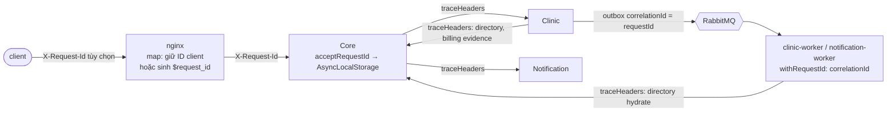

# Observability

Yêu cầu: [NFR09](../../phase2-plan/06-functional-nonfunctional-requirements.md). Theo dõi được request → operation/event bằng ID; có latency/error, CPU/RAM, pool/lock wait, outbox age, queue/retry/DLQ, operation pending; liveness và readiness tách bạch.

Nền tảng dùng chung nằm ở [`packages/runtime/src/http.ts`](../../packages/runtime/src/http.ts) (`ServiceRuntime`).

## 1. Request ID và correlation

| Điểm          | Cơ chế                                                                                                                                                                             | File                                                                                                                                                                      |
| ------------- | ---------------------------------------------------------------------------------------------------------------------------------------------------------------------------------- | ------------------------------------------------------------------------------------------------------------------------------------------------------------------------- |
| Nhận ID       | `acceptRequestId`: chỉ nhận UUID chuẩn hoặc 32 hex (dạng `$request_id` của nginx); giá trị khác bị thay bằng UUID mới, không echo hay log. ID được trả lại ở header `X-Request-Id` | `packages/runtime/src/http.ts`                                                                                                                                            |
| Trong process | `AsyncLocalStorage`; `currentRequestId()`; `traceHeaders()` cho mọi lời gọi service-to-service                                                                                     | `http.ts`                                                                                                                                                                 |
| HTTP nội bộ   | Core proxy → Clinic/Notification; Core billing → Clinic; Clinic → Core directory/billing evidence; Notification → Core authorization                                               | `backend/src/composition/{coreApp,appointmentBilling}.ts`, `services/clinic/src/infrastructure/core/{directory,directorySync}.ts`, `services/notification/src/coreAuthorization.ts` |
| Sự kiện       | Envelope bắt buộc có `correlationId`. Outbox notification dùng requestId; billing event dùng `operationId` (operation đã được log kèm requestId)                                        | `packages/contracts`, `services/clinic/src/infrastructure/messaging/notificationOutbox.ts`, `backend/src/composition/appointmentBilling.ts`                               |
| Consumer      | Mỗi event được xử lý trong `withRequestId(correlationId)`, nên log và HTTP phát sinh (vd hydrate directory) mang cùng ID                                                           | `services/clinic/src/worker.ts`, `services/notification/src/consumer.ts`                                                                                                  |
| Gateway       | `map $http_x_request_id $req_id { default $http_x_request_id; "" $request_id; }`; log và forward cùng `$req_id`                                                                    | `deploy/phase2/nginx.split.conf.example`                                                                                                                                  |

**Thay đổi ngày 22/10/2026** (trước đó chuỗi ID bị đứt ở ba chỗ):

1. Runtime chỉ nhận `/^[0-9a-f-]{36}$/`, nên `$request_id` của nginx (32 hex) bị thay ID mới ở service đầu tiên; log gateway và log service không nối được.
2. Consumer chạy ngoài request context.
3. `directorySync` không gửi `traceHeaders`.

Regex mới chặt hơn bản cũ: bản cũ nhận cả chuỗi 36 dấu gạch.

**Kiểm:** `packages/runtime/tests/request-id.test.mjs` (4 test). Test HTTP dựng hai service thật trong process: ID dạng nginx đi qua A → B, xuất hiện ở response và trong access log của cả hai service; ID giả mạo bị thay và không xuất hiện trong log.

**Hồi quy trên project test (22/10):**

- PASS: runtime 12/12; `phase2:test:resilience`, `clinic`, `notification`, `billing`, `runtime`; `integration` 12/12.
- ~~Fail có từ trước: `notification-runtime` hỏng do 369 outbox event cũ trong DB thử~~ → đã sửa harness 22/10 (Core worker chỉ relay event của run qua `OUTBOX_CREATED_AFTER`, có guard); `notification-runtime` 9/9, E2E 18/18 (lịch sử kiểm thử).

## 2. Log

- **Access log:** mỗi request một dòng JSON gồm `service`, `instance`, `requestId`, `route` (template, không có query string hay ID), `method`, `status`, `latencyMs`. Không ghi body, credential hay lỗi thô.
- **Sự kiện:** `logEvent` (`packages/messaging`) ghi `eventId`, `correlationId`, `eventType` và trạng thái (`publish-confirmed`, `acknowledged`, `retry-confirmed`, `dlq-confirmed`).

## 3. Metrics (`GET /metrics`, cần `OBSERVABILITY_TOKEN`, không public qua gateway)

| Nhóm                            | Metric                                                                                                        |
| ------------------------------- | ------------------------------------------------------------------------------------------------------------- |
| HTTP                            | `pet_http_duration_seconds_{bucket,sum,count}` theo method, route template, status                            |
| Backlog và hợp nhất             | `outbox_pending`, `outbox_oldest_seconds`, `billing_pending`, `billing_oldest_seconds`, `db_lock_waits`       |
| Hàng đợi (Clinic, Notification) | `queue_ready`, `retry_ready` (P03: message đang chờ retry), `dlq_ready` (đã chết); -1 khi chưa đọc được queue |
| Limiter                         | `limiter_shared_total`, `limiter_rejected_total`, `limiter_degraded_total`, `redis_failures_total`            |
| Phụ thuộc (0/1)                 | `db_available`, `broker_available`, `redis_available`                                                         |
| Process                         | `cpu_seconds_total`, `rss_bytes`, `event_loop_p99_seconds`                                                    |

Tên xuất thật có tiền tố `pet_` (ví dụ `pet_dlq_ready`) và label `service`. Label không chứa userId hay eventId, để tránh số chuỗi metric tăng không giới hạn. Gauge hàng đợi luôn là -1 ở Core (Core không đọc queue); outbox của Notification luôn 0 (Notification không có outbox).

## 4. Health

| Endpoint        | Ý nghĩa                                                                                                                                                                                     |
| --------------- | ------------------------------------------------------------------------------------------------------------------------------------------------------------------------------------------- |
| `/health/live`  | Process còn sống                                                                                                                                                                            |
| `/health/ready` | 200 khi DB của chính service dùng được và service không đang drain. Body báo `ready`/`degraded` theo Redis, broker và backlog. Broker lỗi **không** làm API unready nếu vẫn ghi được outbox |

Gateway trả 404 cho `/internal`, `/metrics`, `/health`; được kiểm tự động trong `arch:check` ([09](09-fitness-functions.md)).

## 5. Giới hạn

- Chưa có distributed tracing (span/OpenTelemetry), chỉ có correlation bằng ID trong log.
- Lời gọi HTTP do worker billing khởi tạo (ngoài request) dùng ID mới; liên kết với operation qua `operationId` trong URL và log.
- Môi trường thử Kaggle (`stack.mjs`, harness Q6 đã pin) vẫn chạy runtime cũ của bundle. Thay đổi này áp cho build hiện tại.

## 6. SLO và cảnh báo

Các rule nằm ở [`deploy/phase2/alerts.json`](../../deploy/phase2/alerts.json), dạng máy đọc được: mỗi rule có `name`, `metric`, `service`, `condition`, `threshold`, `for` và `why`. Cột "Vì sao" bên dưới là bản rút gọn của `why`.

**Ngưỡng và thời gian `for` là đề xuất cho quy mô đồ án (khoảng 100 người dùng), chưa phải SLO đã đo.** Chỉnh lại sau lượt tải đầu tiên. Ngưỡng nào dựa vào hằng số trong code thì ghi hằng số đó.

| Rule                    | Metric                             | Service                    | Điều kiện, `for`                  | Vì sao                                                                                                                                                                                                                                                                                                                                                                                                                                                                                      |
| ----------------------- | ---------------------------------- | -------------------------- | --------------------------------- | ------------------------------------------------------------------------------------------------------------------------------------------------------------------------------------------------------------------------------------------------------------------------------------------------------------------------------------------------------------------------------------------------------------------------------------------------------------------------------------------- |
| `DlqNotEmpty`           | `pet_dlq_ready`                    | Clinic, Notification       | `> 0`, 1 phút                     | DLQ không ai consume; vào DLQ nghĩa là lỗi vĩnh viễn hoặc hết thang retry, cần người xử lý (`replay-event.mjs`)                                                                                                                                                                                                                                                                                                                                                                             |
| `RetryBacklogSustained` | `pet_retry_ready`                  | Clinic, Notification       | `> 0`, 15 phút                    | Một message rời retry trong khoảng 12,6 phút (thang mặc định cộng 756 s); lâu hơn nghĩa là lỗi mới liên tục tới, thường do Core hoặc DB chết                                                                                                                                                                                                                                                                                                                                                |
| `ConsumerQueueBacklog`  | `pet_queue_ready`                  | Clinic, Notification       | `> 500`, 5 phút                   | Consumer khỏe ack trong mili giây nên độ sâu gần 0; 500 là ngưỡng thả lỏng                                                                                                                                                                                                                                                                                                                                                                                                                  |
| `QueueUnreadable`       | `pet_queue_ready`                  | Clinic, Notification       | `< 0`, 5 phút                     | -1 là không đọc được queue (sai `BROKER_PREFIX`, queue chưa khai báo)                                                                                                                                                                                                                                                                                                                                                                                                                       |
| `OutboxLagHigh`         | `pet_outbox_oldest_seconds`        | Core, Clinic               | `> 120`, 5 phút                   | Relay retry với backoff tối đa 60 s; quá 120 s nghĩa là hai lần retry tối đa đều hỏng                                                                                                                                                                                                                                                                                                                                                                                                       |
| `OutboxPendingHigh`     | `pet_outbox_pending`               | Core, Clinic               | `> 5000`, 5 phút                  | `OUTBOX_SOFT_LIMIT` 10000 làm `/health/ready` thành `degraded`, `OUTBOX_HARD_LIMIT` 20000 làm ghi trả 503; 5000 là nửa soft limit                                                                                                                                                                                                                                                                                                                                                           |
| `BillingOperationStuck` | `pet_billing_oldest_seconds`       | Core                       | `> 300`, 5 phút                   | Worker `core-billing` quét mỗi 0,5 s; 5 phút nghĩa là nó dừng hoặc không gọi được Clinic. Không áp cho Clinic vì ở đó gauge là tuổi reservation HELD, vốn có thể lâu                                                                                                                                                                                                                                                                                                                        |
| `Http5xxRatioHigh`      | `pet_http_duration_seconds_count`  | Core, Clinic, Notification | tỷ lệ status 5xx `> 0,05`, 5 phút | Cứ 20 response có hơn 1 lỗi là người dùng thấy. Lỗi lạ trả 500 `INTERNAL_ERROR`, dependency không sẵn sàng trả 503 kèm `Retry-After`, cả hai đều tính. Body bị parser từ chối (sai JSON, quá lớn, charset lạ) trả 4xx của chính nó, nên không tính (commit `63f47da`)                                                                                                                                                                                                                       |
| `CircuitOpen`           | `pet_circuit_rejected_total`       | Core, Clinic               | `increase(...[2m]) > 0`, 1 phút   | Breaker mở sau 5 lỗi liên tiếp, nhãn `target` là `clinic-gateway`, `notification-gateway` (Core) hoặc `core-directory` (Clinic). Mỗi lần breaker từ chối là một 503 tới người dùng, nên có từ chối trong 2 phút nghĩa là dependency đang lỗi. Khi dependency trả lời lại, lần gọi thử kế tiếp (5 s một lần) đóng breaker và việc từ chối dừng. Không đặt alert trên `pet_circuit_open` vì gauge này chỉ bằng 1 khi breaker đang từ chối, nên nó bật tắt giữa các lần thử (commit `f7d39d5`) |
| `HttpLatencyP95High`    | `pet_http_duration_seconds_bucket` | Core, Clinic, Notification | p95 `> 2` s, 10 phút              | 2 s là timeout của lời gọi Clinic tới Core; histogram có bucket `le="2"`                                                                                                                                                                                                                                                                                                                                                                                                                    |
| `DatabaseUnavailable`   | `pet_db_available`                 | Core, Clinic, Notification | `== 0`, 1 phút                    | `/health/ready` trả 503 và ghi bị từ chối; 1 phút đủ cho một lần restart DB                                                                                                                                                                                                                                                                                                                                                                                                                 |
| `BrokerUnavailable`     | `pet_broker_available`             | Core, Clinic, Notification | `== 0`, 5 phút                    | Cảnh báo, không phải sự cố: API vẫn chạy nhờ outbox. Nếu kéo dài thì hai rule outbox bật tiếp                                                                                                                                                                                                                                                                                                                                                                                               |
| `DatabaseLockWaits`     | `pet_db_lock_waits`                | Core, Clinic, Notification | `> 5`, 2 phút                     | Session của role service đang chờ lock; hàng chờ sau khóa ACCESS EXCLUSIVE của migration ([runbook](../../deploy/phase2/migration-a-runbook.md))                                                                                                                                                                                                                                                                                                                                            |

**Kiểm tự động:** [`tools/phase2/check-alert-metrics.mjs`](../../tools/phase2/check-alert-metrics.mjs), chạy trong `npm run arch:check`. Nó đọc `alerts.json` và `packages/runtime/src/http.ts` (nơi duy nhất sinh `/metrics`), rồi báo lỗi nếu một rule dùng metric không được xuất, nếu `condition` không chứa metric hoặc ngưỡng của rule, hoặc nếu tên rule không xuất hiện trong mục này. Tên được so khớp đầy đủ: `pet_dlq` hay `dlq_ready` (thiếu `pet_`) đều bị bắt. Negative fixture nằm ngay trong script.

**Circuit breaker** (từ commit `8d44772`): mỗi `CircuitBreaker` tự đăng ký (tham chiếu yếu) khi tạo, và `/metrics` xuất `pet_circuit_open{target}`, `pet_circuit_opened_total{target}`, `pet_circuit_rejected_total{target}`. Từ commit `f7d39d5`, `pet_circuit_open` chỉ bằng 1 khi breaker đang từ chối, ở half-open thì bằng 0, nên hệ thống vắng request không còn báo động giả. Log `CIRCUIT_OPEN`, `CIRCUIT_HALF_OPEN`, `CIRCUIT_CLOSED` trên stderr vẫn giữ để tra thời điểm chính xác.

**Limiter:** GET/HEAD ngoài `/auth` và `/public` dùng cửa sổ trong bộ nhớ của từng instance (commit `049b8a5`), số cửa sổ đang giữ ở gauge `pet_limiter_local_total`, tối đa `LOCAL_LIMITER_MAX_ENTRIES` (mặc định 10000). Ghi và đường auth/public vẫn dùng Redis.
