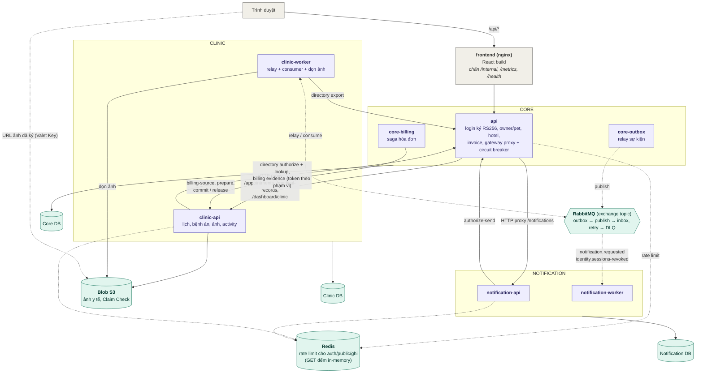

# Kiến trúc hệ thống

Nét liền: HTTP đồng bộ (9 lời gọi, khai trong `deploy/phase2/service-calls.json`). Nét đứt: sự kiện qua RabbitMQ, rate limit, tải ảnh trực tiếp.

## Các cải tiến chính

| Việc                                   | Vấn đề trước đây                                                  | Cách làm                                                | Kết quả                                                                   |
| -------------------------------------- | ----------------------------------------------------------------- | ------------------------------------------------------- | ------------------------------------------------------------------------- |
| **Tách 3 service, mỗi service một DB** | Monolith dùng chung một DB, các phần dính vào nhau                | Core, Clinic, Notification; cấm đọc DB của service khác | Cái giá đo được so với monolith: p95 **×2,78**, CPU mỗi request **×4,72** |
| **Queue riêng cho thu hồi phiên**      | Lệnh khóa tài khoản xếp sau 500 thông báo, token cũ vẫn dùng được | Cho lệnh thu hồi một queue riêng                        | **4,4–5,8 s → 19–30 ms**                                                  |
| **Clinic hỏi Core 1 lần**              | Mỗi trang danh sách gọi Core 2 lần, Core đã gần quá tải           | Gộp thành 1 lần cho cả trang                            | p95 danh sách lịch **×0,603**                                             |
| **Claim Check cho ảnh**                | Ảnh lưu trong DB, danh sách nặng                                  | Ảnh ra bucket, trình duyệt tải bằng URL ký sẵn          | **800 KB → 1,9 KB**                                                       |
| **Gỡ CQRS**                            | Thêm bản đọc riêng nhưng tốn công giữ đồng bộ                     | Đo trước rồi mới quyết                                  | Chậm hơn **×1,25**, nên đã gỡ                                             |
| **Dọn cấu trúc code**                  | Code Clinic nằm ngoài các tầng; phụ thuộc ngược chiều tầng        | Chia tầng, thêm kiểm tự động                            | **1.840 → 247 dòng**; phụ thuộc ngược **16 → 0**                          |

Ghi chú: 800 KB → 1,9 KB làm tròn từ 800.106 → 1.870 byte. Số p95, CPU và ×0,603 đo trên VM FPT 8 vCPU, 100 user; ×1,25 đo trên Kaggle.
