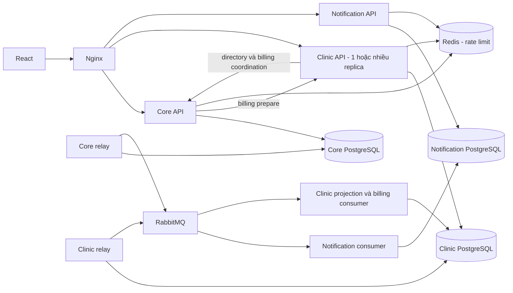

# 01 — Kiến trúc và các quyết định

## 1. Nền hiện tại

| Nguồn                                                  | Giá trị dùng lại                                                              | Điều không được suy diễn                                                       |
| ------------------------------------------------------ | ----------------------------------------------------------------------------- | ------------------------------------------------------------------------------ |
| `main` tại `add596e`                                   | API v3 có phân trang; Express/application/ports/infrastructure; Prisma; React | Working tree có thay đổi chưa commit; SHA không mô tả toàn bộ file trên máy    |
| `refactor` tại `139e4dd`                               | Sửa refresh theo trang, lịch và hóa đơn                                       | Chưa tích hợp nguyên commit; phải đối chiếu sửa lịch riêng trên main           |
| `experiment/phase2-notification-service` tại `c5736ed` | Contract JSON Schema và harness thử tải                                       | Chưa có runtime Notification độc lập, outbox và DB riêng trong cây đã khảo sát |
| `migration/spring-boot` tại `6c50736`                  | Tham khảo cách lắp ghép dependency và tests                                   | Chưa có phân trang tương đương main; không dùng làm nền pha 2                  |

Refs là bản cục bộ quan sát ngày 11/10/2026. Không coi kết quả test lưu trong nhánh là kết quả chạy lại.

## 2. Container và quyền sở hữu



Mũi tên HTTP hai chiều không được thành chuỗi gọi vòng trong một request: endpoint nội bộ directory và operation-status chỉ đọc Core DB, không gọi ngược Clinic. Relay và consumer có thể là entrypoint worker riêng trong cùng package service; không là miền nghiệp vụ thứ tư.

| Service             | Dữ liệu nguồn thật                                                                                                                                            | Được giữ bản sao                                                                           | Không được làm                                                                  |
| ------------------- | ------------------------------------------------------------------------------------------------------------------------------------------------------------- | ------------------------------------------------------------------------------------------ | ------------------------------------------------------------------------------- |
| Core                | User/OwnerActivation/Pet; HotelBooking/HotelBookingRequest/DailyCareNote; Invoice/InvoiceItem/PaymentAttempt/PaymentEvent; RescueReport; history `kind=hotel` | Snapshot appointment để hóa đơn giữ lịch sử; trạng thái billing operation                  | Query trực tiếp Clinic DB hoặc Notification DB                                  |
| Clinic & Scheduling | Appointment tất cả type, MedicalRecord, MedicalImage, history `kind=appointment`, BillingReservation, RequestDedup, outbox/inbox                              | DirectoryProjection tối thiểu của owner/pet/staff phục vụ search/related; có sourceVersion | Sửa tài khoản/mật khẩu/tiền đã thu; lấy projection làm quyền truy cập cuối cùng |
| Notification        | Notification, InboxEvent, RequestDedup                                                                                                                        | ID người nhận và nội dung đã được producer cho phép                                        | Đọc bảng User hoặc Appointment bằng SQL; phát JWT người dùng                    |

Không sao chép password, token kích hoạt hoặc ghi chú nội bộ vào event directory. Giá trị tiền VND tiếp tục dùng số nguyên và kiểm tra giới hạn; ngày nghiệp vụ tiếp tục theo Asia/Ho_Chi_Minh.

DB riêng nghĩa là quyền truy cập riêng. Local demo có thể một PostgreSQL server với ba database và ba role không có quyền chéo; vẫn chia sẻ CPU/IO và không cách ly lỗi server. Khi benchmark cô lập tài nguyên DB cần nêu rõ topology và quota, có thể dùng ba instance nếu máy đủ sức.

## 3. Tại sao gom Clinic với Scheduling

`AppointmentService` và unique index hiện tại bao phủ cả khám lẫn `spa_*`. `MedicalRecordsService.create` vừa tạo bệnh án vừa hoàn tất lịch trong một transaction. Giữ các invariant này trong cùng DB giảm giao dịch phân tán. Trade-off: tải lịch Spa vẫn cùng tài nguyên Clinic; không tuyên bố Spa đã được cách ly khỏi khám.

Không tạo Auth riêng trong phạm vi chính. Core cung cấp login/register/profile/activation; Clinic và Notification kiểm JWT cục bộ. Chỉ đề xuất Identity & Customer sau P0 đo thấy băm mật khẩu gây nghẽn và có thời gian migration User, activation, FK cùng dữ liệu liên quan.

## 4. Cấu trúc repo đề xuất

```text
backend/                         # Core, giữ đường dẫn để giảm thay đổi
  src/{domain,application,infrastructure,routes,composition}/
  src/index.ts                   # API startup/shutdown
  src/worker.ts                  # Core outbox relay và reconciliation
  prisma/                        # chỉ Core schema và migration mới
services/
  clinic/
    src/{domain,application,infrastructure,routes,composition}/
    src/{index,worker}.ts
    prisma/
    tests/
  notification/
    src/{domain,application,infrastructure,routes,composition}/
    src/{index,worker}.ts
    prisma/
    tests/
packages/
  contracts/                     # JSON Schema, DTO wire, validator; không Prisma
  observability/                 # correlation/log/metrics helpers nhỏ
frontend/                        # UI và URL công khai giữ ổn định
deploy/phase2/                   # Nginx, Compose, init DB roles, env.example
tools/phase2/                    # migration, kiểm tra, sự cố và benchmark
phase2-plan/                     # bộ thiết kế này + evidence/ khi triển khai
```

Mỗi service build độc lập, sinh Prisma client vào output riêng; không để nhiều schema ghi đè cùng `@prisma/client` trong workspace. Không import source nội bộ, Prisma model hay repository của service khác. Chia sẻ wire contract, không chia sẻ một domain model buộc các service nâng cấp cùng nhau. Không đổi đồng loạt dependency chỉ để “lên bản mới”; chốt version tương thích lockfile sau kiểm tra.

## 5. Định tuyến và frontend

| Prefix công khai                                                                 | Owner đích                                                   |
| -------------------------------------------------------------------------------- | ------------------------------------------------------------ |
| `/api/auth`, `/api/owners`, `/api/pets`, `/api/public`                           | Core                                                         |
| `/api/hotel-bookings`, `/api/hotel-care-notes`, `/api/invoices`, `/api/payments` | Core                                                         |
| `/api/operations`                                                                | Core; tra trạng thái lập hóa đơn bất đồng bộ                 |
| `/api/appointments`, `/api/medical-records`                                      | Clinic                                                       |
| `/api/notifications`                                                             | Notification                                                 |
| `/api/dashboard/core`, `/api/dashboard/clinic`                                   | Core và Clinic tương ứng; endpoint mới                       |
| `/api/bootstrap`                                                                 | Core adapter tương thích tạm thời, không đọc DB dịch vụ khác |
| `/internal/*`, `/metrics`                                                        | Chỉ mạng nội bộ, không proxy ra browser                      |

Kiểm kê mọi operation từ `backend/openapi.json` trong P0; bảng prefix không thay thế danh sách operation. Đặc biệt GET collection đang được route ở `routes/lists.ts` trước các write router: phải chuyển cả read lẫn write.

Session chỉ giữ actor/token và trạng thái xác minh. Mỗi trang sở hữu query với key gồm phiên đăng nhập/scope, filter và page. Logout đổi key và hủy request; response cũ không được ghi vào phiên mới. Mutation chỉ invalidates vùng liên quan. Thành công ghi dữ liệu và thất bại reload là hai trạng thái khác nhau.

Dashboard tải các vùng độc lập; một vùng hỏng giữ dữ liệu cũ kèm thời điểm/trạng thái hoặc hiện lỗi, không hiện số 0 giả. Bỏ timer bootstrap toàn cục; chỉ polling dữ liệu có nhu cầu thực, visible/online, có jitter và backoff. Chưa bắt buộc SSE/WebSocket. Không đổi giao diện nghiệp vụ lớn trong lúc tách backend.

## 6. Auth và tải truy cập

Phát hiện baseline: một limiter 50 request/15 phút/IP áp cho toàn bộ `/api/auth`, cả `/me`; PBKDF2 async 210.000 vòng đã dùng trên đường HTTP; middleware JWT không gọi DB mỗi request. Cần tách limiter login/register/activation, giới hạn API hồ sơ theo actor và IP, giữ hỗ trợ nhiều khách chung Wi-Fi. Tham số cụ thể phải cấu hình và đo, không coi một con số mặc định là năng lực hệ thống.

Redis lưu counter dùng chung; nếu Redis lỗi: auth write/login có thể trả 503 rõ ràng sau timeout ngắn, không âm thầm bỏ limiter; luồng đọc có JWT vẫn dùng giới hạn cục bộ bảo vệ tải và ghi degraded. Kiểm thử chính sách này thay vì coi Redis là điều kiện readiness cho mọi API. Giới hạn concurrency và pending queue của PBKDF2; không giảm iterations. Không log password/token, body auth hoặc URL chứa bí mật.

Đích pha 2: Core ký access token bằng private key, service khác chỉ giữ public key; cho phép cố định thuật toán, issuer, audience và `kid`. Không tự thêm refresh-token feature. Trong cutover local/demo phối hợp frontend và yêu cầu đăng nhập lại; không cấp khóa ký cho Clinic để giữ token legacy hoạt động. Chốt thời hạn token và độ trễ thu hồi trong ADR; xác minh token cục bộ không có nghĩa thu hồi tài khoản có hiệu lực tức thì.

Internal HTTP dùng credential service riêng với audience/permission cụ thể; nếu có actor context, phải ràng buộc bằng token đã xác minh. Header actor tự khai không là bằng chứng quyền. API nội bộ phải kiểm tra role và scope, có timeout và response schema.

## 7. Health, scale và quan sát

- Liveness chỉ phản ánh tiến trình. Readiness API yêu cầu DB của mình và migration đúng; broker dừng không tự loại toàn bộ Core/Clinic khỏi load balancer nếu vẫn ghi outbox được.
- Backlog outbox có giới hạn dung lượng được giám sát; gần ngưỡng phải báo degraded và có chính sách admission, không nhận vô hạn rồi đầy ổ đĩa.
- Replica API stateless. Request dedup, slot uniqueness và revision nằm trong DB; không dùng Map trong RAM làm invariant.
- Nginx upstream phải có nhiều Clinic instance thực và test phân phối. Demo dùng các instance tên rõ ràng nếu DNS của cấu hình hiện tại không tự cập nhật; không giả định `--scale` đủ.
- Tổng DB connection pool được giữ trong ngân sách khi thêm replica. File ảnh phải truy cập được từ mọi replica; giữ cơ chế storage hiện có nếu phù hợp, không tự kéo thêm dịch vụ lưu trữ mới.
- Log JSON có request/correlation/event/operation ID, service, route template, latency và status. Metric không gắn userId/eventId làm label để tránh số lượng chuỗi quá lớn.
- Dashboard/metrics phải thể hiện HTTP p95, lỗi, CPU/RAM, DB wait, hash duration, outbox age, queue depth, retry/DLQ và billing operation bị kẹt.

## 8. ADR cần có trước cutover

| ADR    | Quyết định khởi đầu                                     | Chỉ đổi khi                                                |
| ------ | ------------------------------------------------------- | ---------------------------------------------------------- |
| ADR-01 | Ba service TypeScript, mono-repo                        | Có yêu cầu mới hoặc số đo/năng lực nhóm chứng minh lợi ích |
| ADR-02 | Clinic chứa tất cả Appointment và bệnh án               | Có phương án giữ chống trùng khám/Spa được test            |
| ADR-03 | Outbox + broker + inbox, at-least-once                  | Không được thay bằng HTTP best-effort trên đường commit    |
| ADR-04 | Billing reservation + Core operation state              | Có giao thức khác chứng minh đầy đủ crash/race invariants  |
| ADR-05 | Directory projection cho search; quyền xác minh từ Core | Có cơ chế cập nhật quyền với độ trễ được chấp nhận rõ ràng |
| ADR-06 | Cutover có dừng ghi ngắn trên dữ liệu thử               | Có CDC/catch-up và đối soát tương đương                    |
| ADR-07 | Identity nằm trong Core, test auth/read surge bắt buộc  | Đo P0 và quyết định phạm vi riêng                          |

Không cần dựng thêm service để làm ADR; lưu quyết định và bằng chứng gọn trong `phase2-plan/evidence/decisions.md` khi triển khai.
