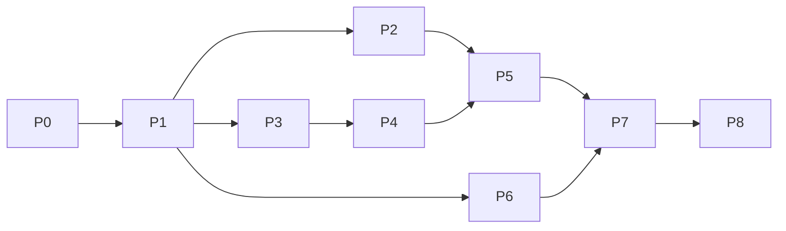

# 03 — Một người tách service trước, bàn giao nhóm sau

Trong giai đoạn đầu, người phụ trách tích hợp hoàn tất việc tách 3 service trước; hai thành viên còn lại nhận bàn giao sau khi ranh giới các service đã ổn định. Kế hoạch không tính công suất ba người trong giai đoạn đầu. Khung một tháng vẫn giữ, nhưng thời gian hoàn thành phải được ước lượng lại sau P1; lịch dưới đây là mục tiêu tham chiếu, không phải cam kết một người chắc chắn làm xong trong 15 ngày.

## 1. Hai giai đoạn nhân lực

**Trước mốc bàn giao H:** bạn là người duy nhất phụ trách toàn bộ code, contract, schema, gateway và tích hợp. Các chặng P0–P7 được triển khai tuần tự theo thứ tự phụ thuộc kỹ thuật. Test và runbook được viết cùng lúc với code. Không cần tách repository; giữ mono-repo với service/workspace độc lập.

**Sau mốc H:** mới phân công vận hành, kiểm chứng, sửa lỗi trong phạm vi và chuẩn bị bảo vệ. Bạn tiếp tục giữ quyền quyết định kiến trúc và tích hợp file chung.

| Người nhận sau H                 | Phạm vi đề xuất                                                                  | Đầu ra                                                    |
| -------------------------------- | -------------------------------------------------------------------------------- | --------------------------------------------------------- |
| Bạn — Core & tích hợp            | Core/auth/billing, contract chung, package/lockfile, Compose/Nginx, review PR    | Bản tích hợp ổn định và quyết định kỹ thuật nhất quán     |
| Thành viên 2 — Clinic            | Kiểm chứng lịch/bệnh án, concurrency, scale Clinic, sửa lỗi cục bộ theo contract | Test report Clinic, số đo tải khám, thuyết minh ranh giới |
| Thành viên 3 — Notification & UI | Replay/sự cố thông báo, frontend E2E, hướng dẫn chạy và demo                     | Test report Notification/UI, video và tài liệu sử dụng    |

Sau bàn giao, mỗi người dùng branch/worktree riêng; không sửa đồng thời lockfile/Compose/AppStoreProvider. API/DB/event thay đổi phải qua người tích hợp. Đây là phân công vai trò giữa các thành viên trong nhóm sau mốc bàn giao H.

## 2. Lộ trình tuần tự và mốc bàn giao

| Ngày mục tiêu        | Người thực hiện                           | Phần việc chính                                                           | Điều kiện qua mốc                                                               |
| -------------------- | ----------------------------------------- | ------------------------------------------------------------------------- | ------------------------------------------------------------------------------- |
| 1                    | Người tích hợp                            | P0: baseline, API/transaction inventory, môi trường thử                   | Biết rõ code hiện tại và test baseline                                          |
| 2–3                  | Người tích hợp                            | P1: workspace/DB riêng; outbox/inbox; thử sớm billing race                | **G1:** proof of concept và test PostgreSQL/broker thật đạt; ước lượng lại lịch |
| 4–5                  | Người tích hợp                            | P2: Notification hoàn chỉnh và producer Core                              | Service đầu tiên tách được, không mất/trùng event                               |
| 6–9                  | Người tích hợp                            | P3: Clinic read/write, bệnh án, directory và pagination                   | Slot/revision/atomicity/phân quyền đạt                                          |
| 10–12                | Người tích hợp                            | P4: billing operation/reservation, pending UI và reconcile                | **G2:** hành trình ba service chạy đúng, crash/race billing đạt                 |
| 13–14                | Người tích hợp                            | P5/P6: bootstrap/frontend, auth surge, bảo mật service, scale và quan sát | Không đổi quyền/nghiệp vụ; test lỗi và replica đạt                              |
| 15                   | Người tích hợp                            | P7: rehearsal dữ liệu thử, hồi quy và gói bàn giao                        | **G3/H:** đủ điều kiện bàn giao trong HANDOFF.md                                |
| 16–18, chỉ khi H đạt | Cả nhóm                                   | P8 benchmark, review từ máy khác và sửa lỗi có bằng chứng                 | Raw results + review + replay/failure demo                                      |
| 19–20                | Cả nhóm nếu đã bàn giao; nếu chưa thì bạn | Báo cáo, chạy từ clone sạch, diễn tập và buffer                           | **G4:** nghiệm thu, công khai mọi phần chưa đạt                                 |

Ưu tiên thứ tự hơn ngày dự kiến. Notification tách trước để tạo mẫu DB/worker/event/test; Clinic dùng lại phần hạ tầng phù hợp. Billing proof of concept vẫn làm sớm ở P1 để tránh cuối tháng mới phát hiện ranh giới không an toàn.

Mục tiêu là dành khoảng năm ngày cuối để nhóm tiếp nhận và bảo vệ, không đợi mọi phần trang trí hoặc báo cáo hoàn hảo mới bàn giao. H yêu cầu P0–P7 đạt, nhưng chưa yêu cầu hoàn tất benchmark P8. Nếu cuối P1 cho thấy lịch vượt khả năng, hoặc G2 trễ khiến không còn khoảng bàn giao, phải báo dự báo mới cùng phương án; không âm thầm giả định hai người kia sẽ giúp tách service sớm, không giảm test correctness và không tự bỏ Clinic.

## 3. Backlog triển khai theo chặng (P0–P8)

Các mã chặng P0–P8 dùng thống nhất trong kế hoạch và STATUS.md. Trước mốc H, toàn bộ P0–P7 được thực hiện tuần tự. P8 được bàn giao theo vai trò sau H. Không đánh DONE bằng việc chỉ tạo scaffold.

### P0 — Baseline và manifest

Đầu vào: working tree hiện có và refs Git. Ghi status, SHA, phiên bản runtime/lockfile, Docker availability; giữ nguyên thay đổi cục bộ. Kiểm kê mọi OpenAPI operation, service owner đích, nguồn query/transaction, UI caller và test có sẵn.

Tạo `phase2-plan/evidence/baseline.md`, `api-inventory.csv`, `local-changes.md`, `test-environment.md`. Không lưu secret, connection string đầy đủ hoặc bản dump thật trong evidence. Xác nhận DB thử riêng trước test ghi dữ liệu. Chạy baseline build/unit/architecture/OpenAPI; integration/E2E chỉ trên môi trường thử đã xác minh. Record test hỏng trước thay đổi.

Đạt khi: phân biệt rõ lỗi baseline với lỗi mới; phiên bản contract và test commands có thật; không mất local changes. Không yêu cầu working tree sạch bằng cách reset/stash tự động.

### P1 — Nền tảng và proof of concept rủi ro cao

Thêm hai workspace service; Prisma output riêng; package contracts; composition root. Compose phase2 riêng không ghi đè stack đang dùng, DB/credential tách, broker và Redis, health/startup/migrations. CI build/test từng workspace và architecture checks chặn import chéo/service SQL chéo. Tạo schema envelope và internal API theo file 02.

Trên DB thử, viết proof of concept có mã dùng tiếp được: outbox→broker→inbox và billing prepare/commit/abort/undo, có fault injection trong test. Test unique slot khám/Spa. Không chuyển traffic thật sang scaffold. Chốt G1 bằng test concurrent commit-vs-abort và prepare-vs-undo; mock unit đơn thuần chưa đủ.

Đạt khi: hai service mới build/start độc lập; DB permission negative test đạt; ít nhất một sự kiện đi qua broker thật; race invariant billing đạt ở PostgreSQL thật.

### P2 — Notification hoàn chỉnh

Port contract phù hợp main từ nhánh thử nghiệm; triển khai API list/unread/read/read-all/delete/send, actor scope, request dedup, inbox, retry/DLQ/replay. Thay mọi NotificationWriter của Core bằng outbox writer trong đúng transaction; Clinic proof of concept dùng cùng pattern. Tạo migration Notification giữ ID/status/timestamps. Manual send kiểm người nhận và quyền qua Core trước commit.

Đạt khi: lỗi consumer/broker không rollback nghiệp vụ đã commit; replay không trùng; xóa notification rồi replay không hồi sinh; owner isolation và pagination đạt; audit tìm mọi `notification.create` còn lại và giải thích nơi hợp lệ.

### P3 — Clinic data và use cases

Chuyển cả GET từ `lists.ts` lẫn write routers; appointment lifecycle và history; bệnh án/ảnh. Tạo schema và migration/index riêng; giữ partial unique slot. Core directory API+events, Clinic projection có version, authorization adapter và response redaction. Thêm idempotency create appointment/record. Không thay đổi giá, status machine hoặc luồng xác nhận để dễ tách.

Đạt khi: đặt khám/Spa không trùng trên nhiều replica; bệnh án/completion atomic; scope/filter/count/related đúng; search projection có test lag; mọi đường đọc/ghi y tế có service owner rõ.

### P4 — Billing liên dịch vụ và compatibility

Triển khai state machine file 02 đầy đủ, Operation API/pending response, reconciler, invoice unique và snapshot. Clinic kiểm reservation dưới cùng lock với undo; `mode=unbilled` dùng state cục bộ trước pagination. Hotel billing giữ nguyên. Chuyển public flow/frontend pending/error và refresh sau commit.

Đạt khi: mọi crash row trong file 02 có test; late commit sau abort bị chặn; invoice commit mất response không tạo trùng; reservation không tự hết hạn dẫn đến invoice+undo; invoice lịch sử sau migration còn đúng.

### P5 — Frontend, bootstrap và đọc theo màn hình

Review/port phần cần từ `139e4dd`, không merge mù. SessionContext riêng; dashboard regions; notification count; page query/filter/debounce/cancel; tách thành công ghi với reload lỗi. Giữ `/bootstrap` adapter đến khi rà soát không còn caller cần nó; không giữ polling global trong runtime đích.

Đạt khi: E2E khám/Spa/hotel/billing/activation/rescue/pagination đạt; lỗi Notification không logout/chặn khám; request phiên cũ không tràn phiên mới; có network evidence số request giảm theo luồng thực.

### P6 — Auth, resilience, scale và quan sát

JWT signing/verification, internal credentials, shared limiter theo nhóm route, hash concurrency admission, Redis degraded policy, startup/shutdown, timeouts, metrics/correlation. Chạy ít nhất hai Clinic replica thật qua proxy; không dùng memory dedup. Các thay đổi auth phải giữ đăng ký/kích hoạt/đổi mật khẩu và mật khẩu hiện có.

Đạt khi: same-IP hợp lệ được xử lý theo chính sách mới, nhiều replica dùng một counter; test Redis/broker/replica down; không log secret; pool tổng và resource budget được ghi. Bổ sung loại bỏ rủi ro đã tìm ra từ P0, không mở scope Identity tự động.

### P7 — Migration, cutover rehearsal và hồi quy

Viết scripts dry-run/export/import/validate theo manifest. Backfill reservation INVOICED cho appointment có invoice cũ; split history theo kind; đồng bộ directory. Dừng ghi có kiểm soát trên stack thử, chuyển ownership/gateway, kiểm tra và thử rollback trước ghi mới. Sau ghi mới chỉ rollback theo kế hoạch đảo dữ liệu đã kiểm chứng hoặc forward-fix.

Đạt khi: report đối chiếu dữ liệu đủ, restore backup trên DB riêng đạt, không hai writer, không FK/service access chéo; tất cả blocker I01–I12 được kiểm chứng.

### P8 — Benchmark và bàn giao cuối kỳ (cả nhóm sau H)

Workload mix gồm khách mới/auth/tra cứu/khám; topology một/nhiều replica; workload version, fixture, SHA và quota đầy đủ. Warmup/repeats và raw data; đo cả nghiệp vụ thành công chứ không chỉ HTTP RPS. Báo cáo giới hạn, không quảng cáo kết quả chưa đo. Tạo runbook, demo scripts và final verification report.

Đạt khi: clone sạch chạy được theo hướng dẫn, G4 có bằng chứng, STATUS khớp thực tế và không còn blocker correctness. Nếu số đo chưa đạt mục tiêu, ghi FAIL/giới hạn và phương án thay vì đánh DONE.

## 4. Dependency và thay đổi phạm vi

Đồ thị biểu diễn phụ thuộc kỹ thuật, không phải lịch làm song song. Các chặng P0→P7 được thực hiện tuần tự để giữ ổn định contract chung trước khi chia việc tại mốc H. Sau H mới chia công việc kiểm chứng P8 và sửa lỗi theo service. Nếu bạn tiếp tục tự làm cả P8 thì dùng cùng dependency, ghi lại thời gian thực tế.

G1 thất bại: tập trung sửa protocol, bỏ optional scope; không cutover Clinic và không tự đổi thành shared DB. G2 trễ: ngừng mọi polish, cache nâng cao/Identity/Reporting. G3 trễ: thu hẹp kịch bản benchmark nhưng giữ toàn bộ test correctness; trình bày phần chưa đạt. Không tự bỏ Clinic đã được người dùng yêu cầu; nếu cần giảm phạm vi nghiệp vụ phải nêu phương án cụ thể để nhóm quyết định.

## 5. Review và bàn giao mỗi chặng

- Tóm tắt thay đổi hành vi và file chính; schema/API/event có diff rõ.
- Kết quả test có command, exit code, môi trường và ngày giờ; không dùng từ PASS cho test chưa chạy.
- Migration có hướng forward và giới hạn rollback.
- Reviewer tập trung transaction, quyền, request retry và tính đúng của pagination trước style.
- Cập nhật STATUS và evidence; giữ bước tiếp theo đủ cụ thể để session khác làm tiếp.
